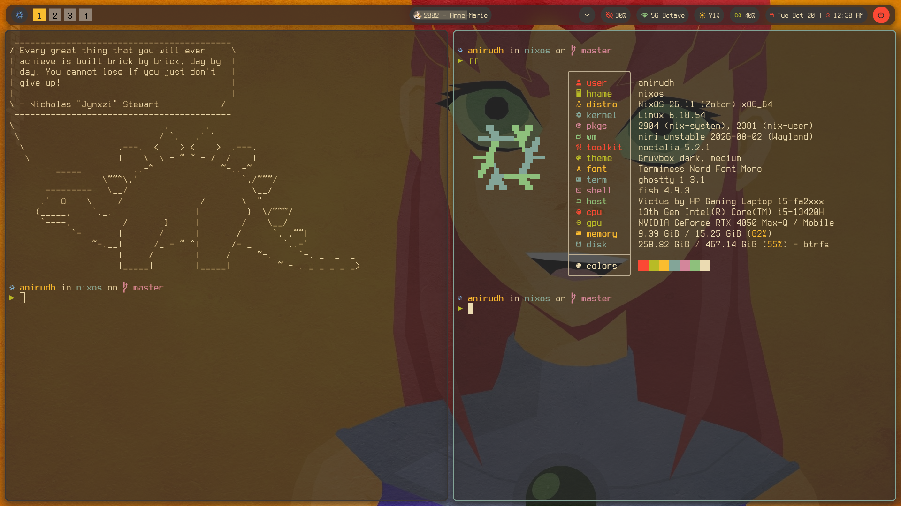
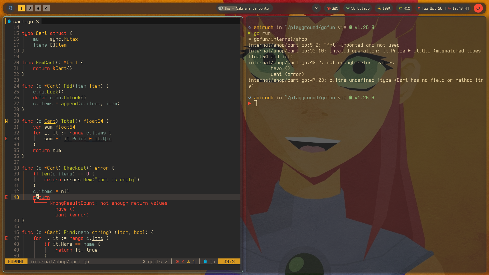
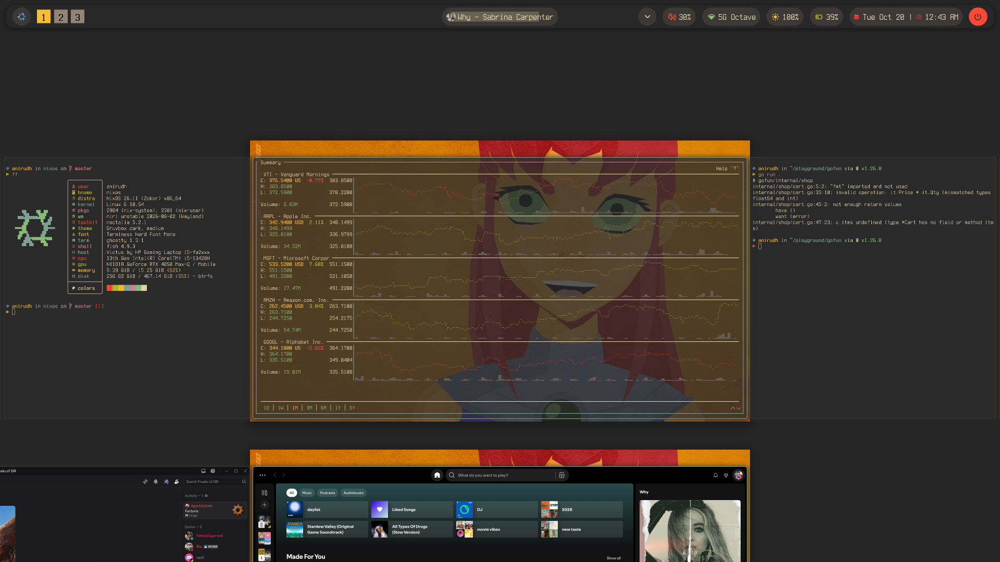
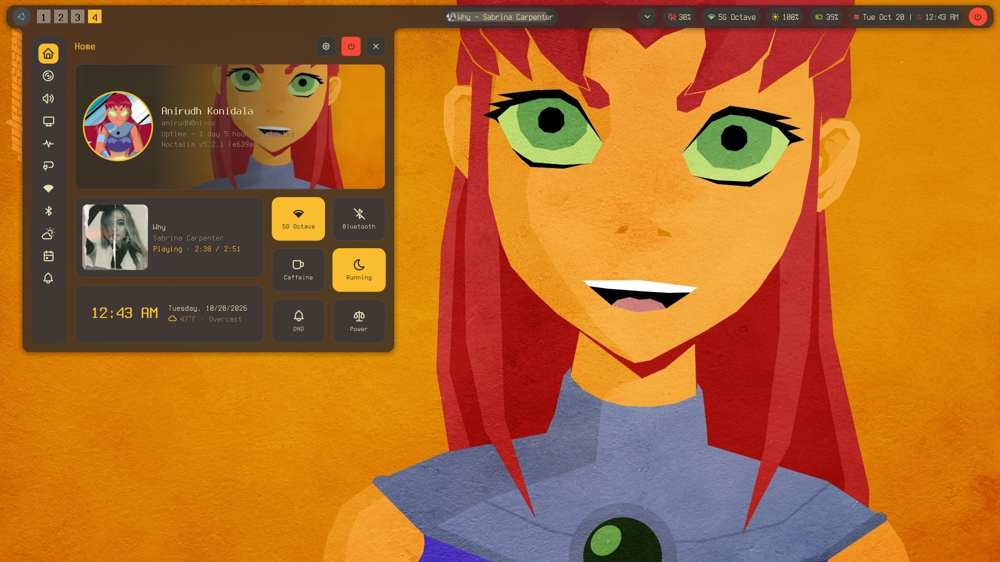

my nixos config!!

CI runs on pushes and pull requests to `main` and `master`, and can also be
started manually. It checks formatting, validates the flake and Noctalia config,
then builds the NixOS system without activating it. The system build starts only
after the other checks pass and has a two-hour timeout.
CI uses the same additional signed binary caches configured in `configuration.nix`
to reuse prebuilt packages where available.

Run the same checks locally using tools pinned by `flake.lock`:

```sh
nix run --no-write-lock-file --inputs-from . nixpkgs#alejandra -- --check .
nix run --no-write-lock-file --inputs-from . nixpkgs#taplo -- fmt --check
nix run --no-write-lock-file --inputs-from . nixpkgs#prettier -- --check "**/*.{json,yaml,yml,md}"
nix flake check --no-write-lock-file --print-build-logs
nix run --no-write-lock-file --inputs-from . noctalia#default -- config validate home-manager/programs/noctalia/config.toml
nix build --no-write-lock-file --no-link --print-build-logs .#nixosConfigurations.nixos.config.system.build.toplevel
```

To fix Nix or TOML formatting, omit `--check`. For Prettier, replace `--check`
with `--write`. Generated lockfiles, encrypted secrets, and local build outputs
are excluded from Prettier.

To enforce CI before merging, configure branch protection in Codeberg after the
first successful run. Require the `format`, `flake-check`, `noctalia-config`, and
`system-build` checks and prevent direct pushes to the protected branch. This is
a repository setting, not something the workflow file enables.





